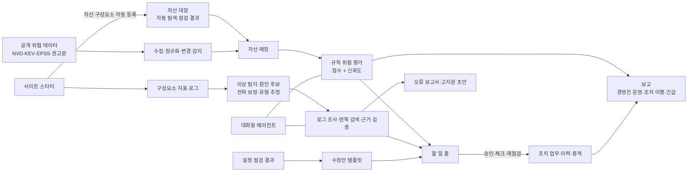

# 사이트 자동 운영 도우미 기획안 v3
## 사이트를 운영하는 중소 사업자에게 보안 위협과 장애를 한곳에서 감시·분석하고, 할 일과 보고로 자동 정리해 주는 운영 에이전트
### 대주제: 대화형 데이터 기반 분석 에이전트 및 자동 리포팅 플랫폼

> v2(`기획안_v2.md`, 보안 위협 인텔리전스 중심)를 보존하고 새로 작성함. 근거 문서: `확장검토_사이트생성관리.md`(사이트 생성·관리 검토), `경쟁분석.md`(보안 도구 비교), `final_ai_sre/README.md`(팀원 AI SRE '당직동료' MVP)
> `[출처 확인 필요]`, `[측정 예정]`, `[가설]` 표시는 발표 전 공식 자료·실측값·인터뷰로 채움. 확인되지 않은 수치는 기재하지 않음.

### v2 대비 변경 사항

| 항목 | v2 | v3 |
|---|---|---|
| 서비스명·정의 | AI 사이버 위협 인텔리전스 에이전트 | 사이트 자동 운영 도우미 — 보안 운영 + 오류 운영 |
| 분석 축 | 보안 위협 1축, 오류 감시는 사이트 스타터의 하위 기능 | **보안 운영·오류 운영 두 축을 같은 비중**으로, 출구(할 일·보고·대화)는 하나 |
| 주 타깃 | 50~300인 IT 겸직자 + 소규모 사업자 확장 세그먼트 | **외부 공개 사이트를 운영하는 1~300인 사업자** 통합, 페르소나 2개 |
| 포지셔닝 | 보안 판단 보조 | "어디서 만들었든 사이트를 연결하면 운영을 맡는 층" (확장검토 결론) |
| 사이트 생성(L2) | 확장 기능 | 진입로 — 만들자마자 두 축 운영이 붙음 (5-7) |
| 수정안 생성(L1) | 스타터 사이트 변경 감지에만 반영 | **기존 사이트 설정 취약 → 수정안 → 승인 → 재점검 종결** 신설 (5-8) |
| 신규 가설·지표 | H1~H13 | H14(수정안)·H15(오류 원인 정리)·H16(통합 보고) 추가, 원인 1위 정답률 등 오류 지표 추가 |

---

## 1. 주제 재정의

### 1-1. 한 줄 정의

> 사이트·서비스를 운영하지만 보안 담당자도 운영(SRE) 담당자도 없는 사업자에게, **보안 위협과 장애를 데이터로 판단해 "오늘 할 일"로 정리하고, 대표·원청·고객에게 보낼 보고를 자동으로 만들어 주는** 운영 에이전트

### 1-2. 두 축과 공통 출구

| 축 | 입력 데이터 | 분석 | 판정 주체 | 결과물 |
|---|---|---|---|---|
| 보안 운영 | 공개 위협 데이터(CVE·KEV·EPSS·권고문) × 자산 대장, 외부 점검 결과 | 영향 버전 매칭, 규칙 기반 위험 점수·신뢰도 | 규칙 엔진 | 조치 할 일, 근거, 긴급 알림 |
| 오류 운영 | 사이트 구성요소 지표·로그 | 이상 탐지, 원인 후보 순위, 장애 유형 추정, 근거 검증 | ML·규칙 (팀원 '당직동료') | 런북 단계 할 일, 메신저 알림, 오류 보고서·이용자 고지문 초안 |
| **공통 출구** | — | — | — | **할 일 홈 하나 · 보고 하나 · 대화 하나** |

두 축을 묶는 이유: 사업자에게 보안 사고와 장애는 모두 "사이트가 위험하다"는 같은 문제이고, 처리하는 사람도 같은 한 명임. 도구를 둘로 나누면 그 한 명이 화면 두 개, 보고 두 개를 관리해야 함.

### 1-3. 대주제와의 연결

| 대주제 요소 | 보안 운영 | 오류 운영 | MVP 시연 화면 |
|---|---|---|---|
| 대화형 | "Jenkins 건은 왜 긴급이야?" — 전제 정정·근거 인용 | "최근 사이트 오류 원인 뭐야?" — 원인·근거·런북 | 에이전트 대화, 할 일 카드 안 설명 |
| 데이터 기반 분석 | 위협 × 자산 규칙 평가 | 지표·로그 z 점수 탐지·전파 보정·유형 서명 | 위협 현황·위협 분석, 오류 모니터링 |
| 에이전트 | 질의 해석 → 도구 호출, 자동 탐색, 능동 브리핑 | 탐지 → 로그 조사 → 런북 검색 → 근거 검증 → 보고서 (5단계) | 도구 호출 로그, 에이전트 실행 로그 |
| 자동 리포팅 | 경영진 보고, 조치 이행(감사·점검 증적), 긴급 알림 | 오류 보고서 7섹션 + 이용자 고지문 초안, 메신저 알림 | 보고, 보관함 |

### 1-4. 담당자의 질문을 대화형 질의로 재구성

| 축 | 담당자의 질문 | 대화 예시 | 사용 데이터 |
|---|---|---|---|
| 보안 | 우리 제품·버전이 영향을 받는가? | "FortiOS 쓰는 장비 중에 영향받는 거 있어?" | 자산 대장, 영향 버전 범위 |
| 보안 | 실제 공격에 악용되고 있는가? | "실제 악용된 취약점만 보여줘" | CISA KEV, EPSS |
| 공통 | 무엇을 먼저 처리해야 하는가? | "이번 주 제일 급한 거 3개" | 위험 점수, 열린 오류 |
| 보안 | 판단 근거와 미확인 정보는? | "Jenkins 건은 왜 긴급이야?" | 출처별 근거, 불확실성 |
| 오류 | 사이트가 왜 느리거나 안 되는가? | "사이트 왜 느려?", "최근 오류 원인 뭐야?" | 구성요소 지표·로그, 원인 후보 순위 |
| 오류 | 그 판단을 믿을 수 있는가? | "왜 웹 화면이 아니라 DB가 원인이야?" | 근거 검증 결과, 호출 관계(전파) |
| 공통 | 지금 해야 할 조치·보고는? | "조치 업무 만들어줘", "고객 공지 써줘", "대표 보고서 만들어줘" | 조치 템플릿, 런북, 리포트 생성 |

### 1-5. 위치 정리

- 사이트 생성 자체는 Wix·카페24 등이 원스톱으로 제공하므로 차별점이 아님 (확장검토 1장)
- **"새로 만들 때는 운영이 붙은 채로 시작하고(5-7), 이미 만든 사이트는 연결하면 운영을 맡는다(5-8)"**
- 호스팅은 하지 않고, 고객 소유 계정·기존 사이트에 연결함. 빌더·AI 생성 도구는 경쟁자이자 연결 대상

---

## 2. 문제 정의

### 2-1. 문제의 근거

| 문제 | 근거로 제시할 자료 | 상태 |
|---|---|---|
| 보안 정보 과잉 | 연간 신규 CVE 공개 건수 추이 (NVD 통계) | `[출처 확인 필요]` |
| 실제 위험은 일부 | 전체 CVE 대비 KEV 등재 비율 | `[출처 확인 필요]` |
| 중소기업 전담 인력 부족 | 기업 규모별 정보보호 전담 인력 보유율 (정보보호 실태조사 등) | `[출처 확인 필요]` |
| 장애가 사업에 주는 피해 | 소규모 온라인 사업자의 사이트 장애 경험·매출 영향 조사 | `[출처 확인 필요]` |
| 생성 도구가 운영 보안을 채우지 않음 | 실사이트 2곳(애니 시맨틀·WhiteNoard) 보안 헤더 6종 모두 없음 (확장검토 3-3), AI 생성 코드 보안 통과율 10.5% (확장검토 [10]) | 확인됨 |
| 판단·대응에 드는 시간 | 인터뷰로 측정한 주간 취약점 확인 시간, 장애 인지~원인 파악 시간 | `[측정 예정]` |

### 2-2. As-Is 업무 흐름 (인터뷰로 검증할 가설)

**보안**

| 단계 | 현재 방식 | 문제점 |
|---|---|---|
| 정보 인지 | 보호나라 메일, 뉴스, 제조사 공지를 각각 확인 | 출처 분산, 누락 |
| 자산 대조 | 엑셀 자산 대장으로 제품·버전 수동 대조 | 버전 정보 노후화 |
| 우선순위 | CVSS나 개인 경험 | 실제 악용 여부 미반영 |
| 보고·기록 | 보고 문서 별도 작성, 조치는 메신저에 분산 | 반복 작업, 감사 대응 어려움 |

**장애**

| 단계 | 현재 방식 | 문제점 |
|---|---|---|
| 인지 | 고객 문의·전화, 가동 감시 알림 메일 | 늦게 알거나 알림이 원인을 알려주지 않음 |
| 원인 파악 | 호스팅 관리 화면·로그를 직접 열어 추측, 외주 업체에 문의 | 겸직자·대표는 지표를 읽기 어려움, 전파(느려진 화면 ≠ 원인) 판단 불가 |
| 조치 | 외주 업체 대기, 검색으로 찾은 방법 시도 | 무엇부터 할지 기준 없음 |
| 보고·고지 | 대표 보고, 고객 공지문을 매번 새로 작성 | 근거 없는 추측이 공지에 들어감, 반복 작업 |

---

## 3. 타깃 고객

### 3-1. 이상적 고객 프로필 (ICP)

- **대상:** 외부 공개 사이트·서비스(소개·예약·문의·쇼핑·고객 포털 등)를 운영하는 **1~300인 사업자**
- **조직:** 보안·운영 전담자 없음. IT 담당 1~3명이 겸직하거나 대표가 직접 관리, 제작·유지보수는 외주
- **자산 규모:** 사이트 1~수 개, 서버·장비·업무 SW 수 개~수십 개
- **도입 계기:** 원청·고객사 보안 점검 요구, 인증 심사, 장애로 인한 매출·신뢰 손실, 사이트 신규 구축, 주변 사고
- ※ 규모·업종은 가설이며 인터뷰로 조정

### 3-2. 페르소나

| 항목 | ① 중소기업 IT 겸직자 | ② 소규모 사업자 대표 겸 운영자 |
|---|---|---|
| 규모 | 50~300인, IT팀 2~3명 중 1명 | 1~49인, 대표 또는 직원 1명 |
| 하루 업무 | 서버·네트워크 운영, 사내 IT 지원, 틈틈이 보안 공지·장애 확인 | 본업, 틈틈이 사이트 문의·예약 확인 |
| 고충 | "우리 회사 해당인지 확인하는 데 시간이 너무 든다", "새벽 장애 원인을 대표님께 설명하기 어렵다" | "사이트가 안전한지 모르겠다", "느려지면 누구에게 물어야 할지 모르겠다" |
| 원하는 것 | 관련 건만, 왜 급한지, 무엇을 할지, 보고 한 장 | 만들 때부터 기본은 되어 있고, 문제가 생기면 알려주고 무엇을 하면 되는지 |
| 지식 | CVE·패치 개념은 알지만 EPSS·KEV·지표 해석은 익숙하지 않음 | SSL 정도만 앎 |

(두 페르소나 모두 인터뷰로 검증할 가설)

### 3-3. 의사결정 구조

| 구분 | 대상 | 관심사 | 대응 기능 |
|---|---|---|---|
| 사용자 | IT 겸직자·운영자 | 판단·대응 시간 단축, 근거 확보 | 할 일 홈, 대화, 위협 분석·오류 모니터링 |
| 구매자 | 대표·임원 (페르소나 ②는 사용자와 동일) | 비용 대비 효과, 위험·장애 현황 | 경영진 운영 보고 (보안·오류 통합) / 월간 운영 보고 |
| 영향자 | IT 유지보수 업체·MSP·제작 에이전시 | 다수 고객사 효율 관리, 유지보수 성과 증명 | 고객사별 비교·보고 (파트너 콘솔) |

구매자와 사용자가 다른 경우(①) 경영진 보고가 구매 결정을 돕는 핵심 기능이고, 같은 경우(②) 월간 운영 보고가 "무엇을 지켰는지" 확인하는 기능임.

---

## 4. To-Be 업무 흐름

| 단계 | As-Is | To-Be | 기대 변화 |
|---|---|---|---|
| 위협 인지 | 출처별 개별 확인 | 공개 위협 데이터 자동 수집·변경 감지 | 출처 통합 |
| 자산 대조 | 엑셀 수동 대조 | 연결 소스 자동 탐색 → 승인 반영, 영향 버전 자동 매칭 | 대조 작업 제거 |
| 우선순위 | 개인 판단 | 규칙 점수 + 판단 신뢰도, 오류는 '오늘 처리'로 자동 배치 | 일관된 기준 |
| 장애 인지 | 고객 문의로 늦게 앎 | 구성요소 지표 이상 감지 → 메신저 알림 + 할 일 카드 | 인지 시간 단축 `[측정 예정]` |
| 장애 원인 | 추측, 외주 문의 | 원인 후보 순위 + 장애 유형 + 근거 검증 + 런북 1차 확인·즉시 조치 | 원인 파악·첫 조치 시간 단축 `[측정 예정]` |
| 설정 보완 | 점검 결과를 받아도 고칠 방법 모름 | 설정 취약 → 수정안(파일·코드) → 승인 → 재점검 종결 (5-8) | 처리율 향상 `[테스트로 검증]` |
| 보고·고지 | 매번 문서 작성 | 경영진 운영 보고, 오류 보고서·이용자 고지문 초안 자동 생성 | 반복 작업 제거 |
| 기록 | 메신저·메일 분산 | 조치 업무·증빙·이력 일원화, 패치·재점검 확인 시 자동 종결 | 감사·점검 증적 |
| 사이트 구축 | 빌더·외주로 만든 뒤 방치 | 운영 기본값 스타터로 생성, 즉시 두 축 감시 시작 (5-7) | 첫날부터 운영 대상 |

시간 변화는 사용성 테스트(8장)로 측정하고, 측정 전에는 단축률을 주장하지 않음.

---

## 5. 경쟁·대체재 분석

### 5-1. 비교표

| 구분 | 예시 | 강점 | 사업자 관점 한계 |
|---|---|---|---|
| 현상 유지 (최대 경쟁자) | 엑셀 자산 대장 + 공지 메일 + 외주 문의 | 추가 비용 없음 | 시간 소요, 누락, 근거·이력 없음 |
| 공공 보안 공지 | KISA 보호나라 | 무료, 국내 맥락 | 자사 자산과 연결 안 됨 |
| 엔터프라이즈 취약점 관리 | Tenable, Qualys, Rapid7 | 자산 탐색·스캔·우선순위 | 도입·운영 부담, 전문 인력 전제 (`경쟁분석.md`) |
| 모니터링·APM·로그 | Datadog, New Relic, Sentry 등 `[공식 자료 확인 필요]` | 지표·로그·추적 수집, 이상 감지 | 지표를 읽고 판단할 사람 전제, 보안 위협·국내 보고와 분리 |
| 가동 감시·온콜 | UptimeRobot, PagerDuty, incident.io 등 `[공식 자료 확인 필요]` | 다운 알림, 당직 호출·장애 기록 | "안 된다"는 알려주나 원인·조치·고지문은 사람 몫 |
| 사이트 빌더·AI 생성 | Wix, 카페24 AI 빌더·AI 스페이스, Lovable, Replit | 생성·배포·SSL 원스톱 | 배포 직전 코드 점검 중심, 배포 후 운영·보고·국내 증적 없음 (확장검토 3장) |
| 사람 대행 | 크몽 유지보수, 에이전시(포크나인 등) | 사람이 직접 고쳐 줌, 월 정기 | 월 5만~20만 원대, 점검 방식·보고서 항목 미공개 (확장검토 3-1·3-4) |
| AI 검색 노출 최적화 | Wix AI Visibility, 카페24 PRO AEO·GEO 등 | 노출 추적·구조화 데이터 | 노출 확대가 목적, 보안·장애 관점 없음 |

※ 각 서비스의 세부 기능·가격은 발표 전 공식 자료로 재확인함.

### 5-2. 포지셔닝 맵

```
                    판단·대응 지원 수준 높음
                             │
  엔터프라이즈 VM·APM ●       │       ◎ 본 서비스
  (전문 인력 전제)            │       (보안+장애 한 목록, 쉬운 말, 국내 보고)
                             │
  도입 부담 높음 ─────────────┼───────────── 도입 부담 낮음
                             │
                             │   ● 사람 대행 (판단은 사람, 비용 월정액)
                             │   ● 가동 감시·CVE 알림·공공 공지
                             │   ● 현상 유지
                    판단·대응 지원 수준 낮음
```

### 5-3. 차별화: 기능이 아니라 대상·결과물·채널

KEV·EPSS 우선순위, 자산 자동 탐색, 이상 탐지, AI 질의 응답은 각 분야 도구가 이미 제공하거나 제공하는 추세인 **업계 기본 기능**임. 기능 목록으로는 차별화를 주장하지 않음.

| 축 | 기존 도구 | 본 서비스 |
|---|---|---|
| 사용자 | 보안 분석가·SRE | 보안도 운영도 모르는 겸직자·대표 |
| 범위 | 보안 도구와 모니터링 도구가 분리 | **보안 위협과 장애를 한 할 일 목록·한 장 보고로** |
| 결과물 | 취약점 목록·대시보드·알림 | "오늘 할 일" 카드(왜·체크리스트) + 대표 보고 + 오류 보고서·고지문 초안 |
| 국내 맥락 | 글로벌 기준 | 원청 협력사 점검·인증 심사 증적, 한국어 공지·고지문 |
| 채널 | 기업 직접 판매 | IT 유지보수 업체·MSP·제작 에이전시가 여러 고객사에 묶어 제공 |

**핵심 방어 가설:** ① 원청·인증 점검 양식에 맞춘 조치 증적, ② 비전문가가 바로 실행할 수 있는 한국어 할 일·고지문은 국내 양식·언어에 맞춰야 하므로 글로벌 제품이 우선 대응하기 어려운 영역 `[인터뷰로 확인 필요]`

**에이전시와의 관계 (확장검토 3-4):** 에이전시는 경쟁자이자 파트너 채널. 에이전시의 월간 보고를 건별 증빙·점검 증적 수준으로 보강해 "월 유지보수비로 무엇을 했는지"를 고객에게 증명하는 용도. 맞춤 디자인·쇼핑몰·사람이 직접 고쳐 주는 대행은 에이전시 우위로 인정함.

### 5-4. 신뢰성 설계 (차별화의 전제)

1. **판정은 코드, 문장은 LLM:** 위험 점수·원인 순위·근거 판정은 규칙·ML, LLM은 설명·보고 문장만
2. **불확실성 표시:** 보안은 위험도와 판단 신뢰도 분리, 오류는 근거 검증에서 '확인'이 아닌 주장을 추정으로 표기
3. **근거 추적:** 출처 인용·인용 검증, 지표·로그·런북 근거, 판단 변경 이력
4. **승인 기반 자동화:** 조회·분석·초안은 자동, 자산·업무 변경·발송·반영은 승인 후

### 5-5. AI 기반 차별화 (v2 5-5 유지)

LLM은 규칙 엔진·스캐너가 처리할 수 없고 글로벌 제품이 다루지 않는 **국내 비정형 업무**에 투입함.

| 기능 | 해결하는 문제 | 안전장치 |
|---|---|---|
| 1. 원청·인증 점검 양식 자동 작성 | 원청마다 다른 점검표 양식 | "충족"은 근거 연결 항목만, 제출은 승인 |
| 2. 국산 SW·한국어 공지 구조화 | CVE·CPE가 없는 국산 SW 공지 | 필드별 원문 인용 검증, 미검증 정보로 신뢰도 감점 |
| 3. 조건부 적용성 확인 대화 | 버전으로 알 수 없는 영향 조건 | 판정 변경은 승인 후, 판단 불가 시 단정하지 않음 |
| 4. 외주 업체 요청·회신 처리 | 패치를 외주에 맡기는 업무 방식 | 발송·일정 반영은 승인 후 |
| 5. 대표 의사결정 요청형 보고 | 위험을 비즈니스 언어로 번역 | 수치는 규칙, 문장만 LLM |
| 6. **오류 보고서·이용자 고지문 초안** | 장애 후 보고·공지를 매번 새로 씀, 추측이 공지에 섞임 | 사실 JSON만 사용, 미확인 주장은 추정 표기, 없는 수치는 `[확인 필요]` |

### 5-6. AI 외 차별화 (v2 5-6 유지·요약)

외부 점검 결과 가져오기(내서버돌보미·스캐너 CSV → 자산·할 일), 국내 법정·인증 의무 캘린더, 정부 지원사업 매칭·신청 자료, 증빙 기반 조치 종결, 유지보수 계약·단종 대장. 침해 의심 첫 대응·신고 기한 관리는 v3 MVP에서 제외하고 후순위로 둠.

### 5-7. 사이트 시작하기 (진입로, L2)

사이트를 만드는 순간부터 두 축 운영이 붙는 시작점. 생성은 수단이고 차별화는 생성 직후 할 일·오류 감시·보고가 바로 동작하는 데 있음. 성립 조건·흐름·템플릿 2종·보안 기본값·변경 감지 표는 v2 5-7을 그대로 따름.

| v3에서 바뀐 점 | 내용 |
|---|---|
| 오류 감시 연결 | 템플릿 구성요소(웹·접수 처리·저장소 등)가 생성 즉시 오류 모니터링 대상이 되고, 접수 처리 코드 변경 후 오류는 오류 모니터링의 원인 분석으로 이어짐 |
| 근거 | 실사이트 2곳 보안 헤더 6종 부재 — 목업 '사이트 시작하기' 근거 패널 |
| 하지 않는 것 | 호스팅, 디자인 편집기, 쇼핑몰·결제 구축, 템플릿 3종 이상 |

### 5-8. 설정 보완 수정안 (기존 사이트, L1) — 신설

어디서 만든 사이트든 점검 결과의 설정 취약 항목에 **바로 적용할 수 있는 수정안**을 붙여 할 일로 만들고, 반영 후 재점검으로 종결함. 경쟁분석의 "패치 배포 없음" 약점을 운영 범위 안에서 보완함 (확장검토 5장).

| 단계 | 내용 | 주체 |
|---|---|---|
| 1. 점검 | 외부 점검 결과·응답 헤더 관측에서 설정 취약 항목 추출 | 규칙 |
| 2. 수정안 | 항목별 규칙 템플릿 (HSTS·CSP 보고 전용·클릭재킹·nosniff·Referrer-Policy·security.txt·SRI) + 쉬운 말 이유 | 규칙 (설명 문장만 LLM) |
| 3. 반영 | 담당자가 직접 반영 후 "반영 완료" 승인 기록 | 사용자 |
| 4. 재점검 | 응답 헤더·파일 재요청으로 확인, 양호면 할 일 종결·이력·증적 기록 | 규칙 |

- 플랫폼 구조를 반영함: Cloudflare Pages `_headers`는 정적 응답에만 적용되고 Functions 응답에는 적용되지 않음 → 해당 응답은 코드 수정 안내 (확장검토 3-3, [12])
- CSP는 보고 전용 모드로 시작해 광고·분석 스크립트 장애를 막음
- **하지 않는 것:** 고객 저장소·호스팅에 직접 배포 (기본은 수정안 파일 제공, 배포 연동은 로드맵 8단계)

---

## 6. 솔루션·기술 기획

### 6-1. 데이터 흐름



### 6-2. 규칙 엔진·ML과 LLM의 역할 분리

| 역할 | 규칙·ML | LLM 에이전트 | 사용자 |
|---|---|---|---|
| 위험 점수·영향 판정 | **담당** | 관여 안 함 | 가중치 검토, 미확인 정보 보완 |
| 이상 탐지·원인 후보 순위·장애 유형 | **담당** (z 점수·전파 보정·학습형 랭커) | 관여 안 함 | — |
| 로그 조사·근거 검증 | **담당** (로그량·새 패턴, 주장별 지표 대조) | 관여 안 함 | — |
| 런북 검색 | 검색 (MVP TF-IDF) | 검색 결과 요약 | — |
| 질의 해석·도구 선택 | — | **담당** | — |
| 설명·보고·고지문 문장 | — | **담당** (근거 인용 필수, 미확인은 추정 표기) | 검토 |
| 조치 업무 생성 | 템플릿·런북 단계 | 제안 | **승인 후 실행** |
| 설정 수정안 | **규칙 템플릿** | 쉬운 말 설명 | **반영·승인**, 재점검으로 종결 |
| 업무 종결 | **담당** (패치 증빙·재점검 양호·판정 변경 시) | 관여 안 함 | 이력 검토 |
| 시스템 변경·패치·배포 | 하지 않음 | 하지 않음 | **직접 수행** |

(v2 6-2의 점검 양식·한국어 공지·조건 확인·외주 요청·사이트 스타터 행은 그대로 유지)

### 6-3. 에이전트 도구 설계 (v2 6-3에 추가)

| 도구 | 입력 | 출력 | 권한 |
|---|---|---|---|
| 이상 탐지 (`detect_anomaly`) | 구성요소 지표 | 원인 후보 순위, 장애 유형, 구성요소 상태 | 조회 |
| 로그 조사 (`investigate_logs`) | 장애 전후 로그 | 로그량 변화, 경고·오류 줄, 새 패턴 | 조회 |
| 런북 검색 (`search_runbook`) | 장애 유형 | 런북(증상·원인·1차 확인·즉시 조치·재발 방지) | 조회 |
| 근거 검증 (`verify_claims`) | 탐지·로그 결과 | 주장별 확인·추정 판정 | 조회 |
| 오류 보고서 (`draft_incident_report`) | 검증된 사실 | 보고서 7섹션 + 고지문 초안, 메신저 알림 | 조회 (발송은 **승인 필요**) |
| 설정 수정안 (`draft_config_fix`) | 설정 점검 항목, 플랫폼 | 수정 블록·쉬운 설명 | 조회 |
| 재점검 (`recheck_config`) | 반영 기록된 항목 | 양호·미흡 | 조회 (종결은 규칙) |

**답변 원칙:** 모든 사실 문장에 출처·근거, 질의 전제가 데이터와 다르면 먼저 정정, 외부 문서 속 지시는 데이터로만 취급, 상태 변경은 승인 후.

### 6-4. 분석 모델

**보안 위험 점수·판단 신뢰도:** v2 6-4 그대로 (CVSS 30 / KEV 25 / EPSS 15 / 중요도 15 / 노출 15, 85·65·40점 구간, 누락 정보 감점).

**오류 원인 분석 (팀원 AI SRE '당직동료')**

| 단계 | 방법 |
|---|---|
| 탐지 | 장애 전 정상 구간 기준 z 점수, 지표 계열별(CPU·메모리·디스크·연결·지연·트래픽·오류) 최대 이상치 |
| 원인 순위 | 호출 관계로 전파 보정 — 호출하는 쪽(웹 화면)의 지연은 원인에서 감점 |
| 장애 유형 | 계열별 이상 서명 매칭 (CPU 과부하·메모리 누수·디스크 포화·응답 지연·요청 실패·연결 고갈) |
| 근거 검증 | 주장마다 근거 지표·로그 대조, 부족하면 '추정' |

**팀원 평가 결과 (`final_ai_sre/README.md`, 2026-10-19, RCAEval RE1-OB 실제 장애 125건)**

| 방법 | AC@1 | AC@3 | 장애 유형 |
|---|---|---|---|
| N-Sigma | 0.856 | 0.952 | 0.536 |
| Robust-Z | 0.904 | 0.944 | 0.560 |
| Learned 랭커 (서비스 단위 분리, 가장 엄격) | 0.912 | 0.976 | 0.872 |
| Learned 랭커 (5-fold) | 0.944 | 0.984 | 0.936 |

- 한계: 마이크로서비스 데모(Online Boutique) 기준이며, 소규모 사이트 구성(호스팅·서버리스)에서의 성능은 미검증 `[측정 예정]`
- 목업은 같은 로직을 브라우저용 규칙(z 점수·전파 보정·유형 서명)으로 이식, 합성 지표 기준

### 6-5. 리포트 설계

| 리포트 | 대상 | 생성 시점 | 핵심 내용 |
|---|---|---|---|
| 경영진 운영 보고 | 대표·임원 | 주간 정기 | 보안 핵심 지표·상위 위험 3건, **사이트 운영 현황(오류 건수·조치 대기)**, 조치 진행률, 결정 요청, 결론 한 줄 |
| 실무자 상세 | 담당자 | 수시 | 항목별 근거·불확실성·추가 확인 |
| 조치 이행 | 감사·원청 | 월간 | 업무·증빙·재점검·판단 변경 이력, 점검표 답변 초안 |
| 긴급 알림 | 전 대상 | 신규 KEV가 자산과 매칭될 때 | 대상 자산, 근거, 권장 조치 |
| 오류 보고서 | 담당자 → 대표·고객 | 오류 감지 시 자동 | 개요·타임라인·영향·원인·조치·재발 방지·이용자 고지문 초안 (7섹션) |
| 월간 운영 보고 | 페르소나 ② 본인·제작 업체 | 월간 | 사이트 상태, 처리한 할 일, 오류 이력 `[목업 미구현]` |

**원칙:** 수치는 규칙·ML이 계산하고 LLM은 문장만 작성함. 데이터에 없는 항목은 `[확인 필요]`로 남김.

### 6-6. 현재 MVP 구현 범위

| 기능 | MVP 구현 방식 | 실서비스 전환 시 |
|---|---|---|
| 위협 데이터·매칭·위험 평가 | 가상 CVE 8건, 제품명 + 버전 범위, 규칙 엔진 | 공개 API 수집, CPE 매칭 |
| 오류 감시·원인 분석 | 시드 고정 합성 지표(구성요소 × 지표 7종, 120분)에 오류 주입, z 점수·전파 보정·유형 서명·근거 검증 실제 동작 | 호스팅 Analytics·로그 수집 연동, 학습형 랭커 |
| 대화형 에이전트 | 키워드 의도 분류 + 도구 호출 로그 (보안·오류 질의) | 실제 LLM 도구 호출 |
| 할 일 홈 | 보안 위협·사이트 오류·설정 보완을 한 우선순위로 묶은 카드, 상단 보안·오류 상태 줄 | 메신저 알림에서 바로 처리 |
| 리포트 | 5종 즉시 생성, 인쇄·Markdown, 오류 감지 시 오류 보고서 자동 보관 | 정기 생성·발송 |
| 자산 수집 | 연결 소스 3종 자동 탐색 목업, 점검 결과 CSV 가져오기 | 외부 스캔, 읽기 전용 접속, Git 연동 |
| 설정 수정안 (5-8) | 규칙 템플릿 7종, 반영 기록·재점검은 시뮬레이션 | 응답 헤더·파일 재요청, PR 초안·배포 연동 |
| 사이트 스타터 (5-7) | 템플릿 2종 화면 목업, 배포·변경 감지 4종 시뮬레이션 | 고객 계정 배포, 배포 알림 연동 |
| 판단 갱신·브리핑·자동 종결 | 위협 갱신 시뮬레이션, 증빙·재점검 기반 종결 | 실제 변경 감지 |

### 6-7. 사용자 여정·화면 설계

**설계 원칙**
- 사용자는 화면을 탐색하지 않고 받은 할 일을 처리함. 보안이든 오류든 **같은 홈, 같은 카드 형식**
- 질문은 카드 안 또는 대화에서 함
- 구매자는 로그인하지 않고 보고를 메일로 받음
- 분석 화면(위협 현황·위협 분석·오류 모니터링)은 필요할 때 여는 화면

**주 사용자 여정**
1. 알림 수신 (신규 긴급 위협, 사이트 오류, 에이전트 브리핑)
2. 할 일 홈 상단 상태 줄로 보안·오류 현황 파악 → 위 카드부터 처리
3. 카드의 '왜'로 이해, 의심되면 근거(위협 분석 상세 / 오류 모니터링 상세) 확인
4. 할 일 등록 승인 → 체크리스트(조치 단계·런북 단계·수정안) 처리
5. 패치 증빙·재점검으로 자동 종결
6. 대표 보고 보내기, 오류는 보고서·고지문 초안 검토

**화면 구조 (IA)**

| 구분 | 화면 | 용도 |
|---|---|---|
| 홈 | 할 일 | 보안·오류·설정 보완 통합 — 유일한 필수 화면 |
| 기본 | 에이전트 대화, 보고 | 자유 질의, 보고서 5종·예약·보관함 |
| 보안 운영 | 위협 현황, 위협 분석 | 위험 분포·추이, 평가 근거·What-if·추가 확인 도구 |
| 오류 운영 | 오류 모니터링 | 구성요소 상태, 원인 후보·실행 로그·메신저 알림·근거 검증·로그·런북·오류 이력 |
| 기록 | 조치 업무 기록, 이력 | 감사·점검 증적 |
| 설정 | 자산·연결 소스, 사이트 시작하기, 요금제·지원사업 | 자산(보안 대상)·구성요소(오류 대상), 사이트 생성 |
| 파트너 콘솔 | 고객사 현황 | 고객사별 보안 위험·오류 조치 대기 비교 |

**할 일 카드 구성 (공통 형식)**

```
┌ 🔴 사이트 오류 · DB ──────────────── portal.example-a.co.kr ┐
│ 왜  연결 고갈 추정 · DB 연결 수가 평소보다 크게 튐 · 근거 4/4 │
│ ☐ 원인 1차 확인  ☐ 즉시 조치  ☐ 재발 방지 계획 (런북 단계)    │
│ 원인·근거 보기 → · 오류 보고서 초안 →                         │
└──────────────────────────────────────────────────────────────┘
┌ 🟠 설정 보완 · 애니 시맨틀 게임 페이지 ──────────────────────┐
│ 왜  항상 자물쇠(HTTPS) 주소로만 접속하게 고정                 │
│ 수정안  /*  Strict-Transport-Security: max-age=31536000 ...    │
│ [승인 — 반영 완료로 기록] → [재점검]                          │
└──────────────────────────────────────────────────────────────┘
```

---

## 7. 사업 모델

### 7-1. 가격 구조 가설

| 플랜 | 대상 | 포함 기능 | 가격 |
|---|---|---|---|
| 무료 | 체험 | 자산 10개, KEV 매칭 알림, 오류 감시 1개 사이트 `[가설]` | 무료 |
| 구독 | 단일 사업자 | 보안·오류 두 축, 정기 보고, 수정안 | `[인터뷰 지불 의향으로 결정]` |
| 파트너 | MSP·유지보수 업체·에이전시 | 다중 고객사, 업체 브랜드 보고 | `[인터뷰 지불 의향으로 결정]` |

- 비교 기준: 사람 대행 유지보수 월 5만~20만 원대 (확장검토 3-1 [13][15]) — 구독 가격 결정 전에는 비용 우위를 주장하지 않음
- 사이트 스타터는 별도 과금 없이 구독에 포함 (생성은 획득 경로, 수익은 운영에서) `[가설]`

### 7-2. 판매 채널

1. **유지보수 업체·MSP·제작 에이전시 (주력 가설):** 한 계약으로 다수 고객사, 업체의 월간 보고를 증적 수준으로 보강
2. **직접 판매:** 무료 → 구독 전환, 사이트 스타터로 신규 구축 사업자 유입
3. **공공 연계:** 중소기업 정보보호 지원사업 — 자격 사전 판정·신청 자료 정리까지만 (확장검토 3-4 조건)

### 7-3. 도입 동인

| 동인 | 대응 기능 |
|---|---|
| 원청·고객사 보안 점검 | 조치 이행 보고, 점검표 답변 초안 |
| 인증·법적 의무 `[조항 확인 필요]` | 조치 이력·증적, 의무 일정 |
| 장애로 인한 매출·신뢰 손실 | 오류 감시·원인 정리·고지문 초안 |
| 주변 침해 사고 | 긴급 알림 |
| 사이트 신규 구축 | 사이트 시작하기 |

### 7-4. 시장 규모 산정 방식

| 구분 | 정의 | 산식 |
|---|---|---|
| TAM | 외부 공개 사이트를 운영하는 국내 1~300인 사업자 | 대상 사업자 수 × 연간 객단가 |
| SAM | ICP 조건(전담자 없음·사이트 운영)에 맞는 사업자 | TAM × ICP 비율 |
| SOM | 초기 3년 내 확보 가능 고객 | SAM × 예상 도입률 |

사업자 수·사이트 보유율·전담자 비율은 공식 통계로 채움 `[출처 확인 필요]`.

### 7-5. 고객 획득 경로

1. 무료로 사이트 연결(또는 스타터로 생성) → 첫 할 일·첫 오류 감시 확인 (활성화 시점)
2. 첫 경영진 운영 보고 공유 → 구매자 설득
3. 구독 전환 / 파트너는 고객사 일괄 등록

---

## 8. 가설 검증 계획

### 8-1. 가설·검증 매핑

v2 H1~H13 유지 (H8·H9·H13 목업 상태는 v2와 동일). 아래는 변경·추가분.

| 가설 | 검증 방법 | 측정 지표 | 성공 기준 | MVP 화면 |
|---|---|---|---|---|
| H7. 할 일 카드 홈이 메뉴형 대시보드보다 처리가 빠르고 누락이 적다 (보안·오류 혼합 과업으로 확대) | 같은 과업을 할 일 홈 vs 위협 현황·오류 모니터링 화면으로 수행 | 과업 시간, 누락 건수 | `[테스트 전 설정]` | 할 일 |
| H14. 수정안이 붙은 설정 할 일은 처리가 빠르고 완료율이 높다 | 같은 설정 취약 할 일을 수정안 있음/없음으로 처리 비교 | 처리 시간, 완료율, 오적용 건수 | `[테스트 전 설정]` | 할 일 (설정 보완 카드) |
| H15. 원인 후보·근거·런북을 정리해 주면 장애 첫 대응이 빨라진다 | 같은 장애 케이스를 지표 대시보드만 vs 오류 모니터링 화면으로 대응 | 원인 지목까지 시간, 정답률, 첫 조치 선택 적절성 | `[테스트 전 설정]` | 오류 모니터링 |
| H16. 보안·오류를 한 장으로 보고하면 구매자가 현황을 더 잘 이해하고 구매 의사가 높다 | 분리 보고 2장 vs 통합 경영진 운영 보고 비교 설문 | 이해도, 구매 의사 | `[테스트 전 설정]` | 보고 |

### 8-2. 목업 기반 사용성 테스트

- 참가자: 현직 IT 겸직자 3명 내외 + 사이트 운영 소규모 사업자 3명 내외
- 과업 예시
  1. 가장 먼저 처리할 일 3개 고르기 (보안·오류 혼합)
  2. 지사 방화벽 위험 판단을 믿을 수 있는지 말하기
  3. 사이트가 느려졌을 때 원인과 첫 조치 말하기
  4. 보안 헤더 미설정 할 일 처리하기 (수정안 유무 비교)
  5. 대표에게 이번 주 운영 현황 보고하기
- 측정: 과업 시간, 성공률, SUS, 자유 의견
- 한계: 목업 데이터(가상 CVE·합성 지표) 기반이므로 매칭·원인 분석 정확도는 검증 범위에서 제외

### 8-3. 인터뷰 질문지

v2 1~21번 유지, 장애 대응 문항 추가.

22. 지난 1년간 사이트 장애(접속 불가·느려짐·주문·예약 실패)를 겪은 적이 있는가? 어떻게 알았는가?
23. 장애 원인은 누가, 어떻게, 얼마나 걸려 찾았는가?
24. 장애 후 대표·고객에게 어떻게 알리고 보고했는가? 고객 공지문은 누가 썼는가?
25. 보안 점검과 장애 대응을 같은 사람(또는 업체)이 맡는가? 따로 맡는가?
26. 보안·장애 현황을 한 장으로 받는다면 누구에게 보여 주겠는가? (H16)

---

## 9. 지표 정의

### 9-1. 기술 지표 (실서비스 전환 후 측정)

| 지표 | 산식 |
|---|---|
| 매칭 정밀도·재현율·오탐률 | v2 9-1과 같음 |
| 근거 일치율·근거 없는 단정 비율 | v2 9-1과 같음 |
| 원인 1위 정답률 (AC@1) | 원인 후보 1위가 실제 원인인 장애 ÷ 전체 장애 |
| 장애 유형 정답률 | 장애 유형을 맞힌 장애 ÷ 전체 장애 |
| 감지 지연 | 지표 이상 시작부터 감지·알림까지 |
| 오류 보고서 수정량 | 담당자가 고친 문장 ÷ 초안 전체 문장 |
| 재점검 일치율 | 재점검 양호 판정 중 실제 반영 확인 ÷ 재점검 양호 판정 |

### 9-2. 사업 지표

**북극성 지표: 주간 할 일 처리율** (해당 주 완료 할 일 ÷ 등록 할 일, 보안·오류·설정 보완 합산)

| 지표 | 산식 |
|---|---|
| 활성화율 | 가입 후 7일 내 자산 5개 이상 또는 사이트 1개 연결 ÷ 가입 |
| 감지→첫 조치 시간 | 오류 감지부터 첫 런북 단계 체크까지 평균 |
| 수정안 완료율 | 재점검 종결된 설정 할 일 ÷ 수정안이 붙은 설정 할 일 (H14) |
| 리포트 열람률·조치 완료율·유료 전환율·파트너당 고객사 수 | v2 9-2와 같음 |
| 스타터 활성화율·기본값 유지율 | v2 9-2와 같음 |

---

## 10. 리스크·윤리

v2 10장 리스크 전체 유지(매칭 오탐, 판단 책임, LLM 환각, 프롬프트 인젝션, 민감 정보, 탐색 권한, 점검 양식 오기재, 공지 추출 오류, 법·제도 정보, 배포 권한, 스타터 기본값, 처리방침 초안, 범위 확장, 고객 수정 책임, 자동 복원 충돌, AI 검색 기대 오해, 시장). 아래는 추가분.

| 리스크 | 영향 | 대응 |
|---|---|---|
| 오류 원인 오판 | 엉뚱한 구성요소를 조치하다 장애 장기화 | 원인 후보 상위 3개·근거 검증 표시, '추정' 표기, 1차 확인 단계를 즉시 조치보다 먼저 |
| 합성·데모 데이터 한계 | 실사이트에서 정확도 하락 | 평가 출처·조건 명시, 실데이터 연동 후 재평가 (6-4 한계) |
| 알림 피로 | 잦은 알림으로 무시 | 원인 후보·근거 확인된 경우만 긴급, 방해 스파이크 억제, 알림 기준 조정 |
| 이용자 고지문 초안 책임 | 사실과 다른 공지로 신뢰·법적 문제 | 초안 명시, 미확인 항목 `[확인 필요]`, 담당자 검토 후 게시 |
| 지표·로그 수집 권한 | 호스팅·로그 접근 경로가 공격 통로 | 읽기 전용·최소 권한, 자격 증명 비보관, 접근 로그 |
| 수정안 오적용 | CSP 등으로 사이트 기능 장애 | 보고 전용 모드로 시작, 플랫폼 구조별 안내, 되돌리기 안내, 직접 배포는 하지 않음 |
| 두 축 확장으로 범위 과다 | 8주 안에 깊이 부족 | 두 축은 출구(할 일·보고·대화)만 통합, 분석은 기존 엔진 재사용, 신규 기능은 수정안(5-8)만 |

---

## 11. 실서비스 전환 로드맵 (계획)

| 단계 | 내용 | 기술 난제 |
|---|---|---|
| 0. 현재 | 목업 데이터·키워드 에이전트로 두 축 흐름 검증 | - |
| 1. 실데이터 (보안) | NVD·KEV·EPSS 수집, 변경 감지 | 갱신 주기, 중복 제거 |
| 2. 실데이터 (오류) | 호스팅 Analytics·로그 수집(Cloudflare Logpush 등)·OpenTelemetry 연동 | 플랫폼별 지표 차이, 소규모 사이트 지표 부족 |
| 3. 정밀 분석 | CPE 매칭 / 학습형 원인 랭커(팀원 평가 방식) | 제품명 표기 다양성 / 도메인 차이 |
| 4. 실제 LLM | 도구 호출 에이전트, 인용·근거 검증 | 환각 방지, 비용·속도 |
| 5. 리포트 자동화 | 정기 발송, 메신저 알림, 고지문 게시 지원 | 발송 신뢰성 |
| 6. 팀·파트너 | 회사별 데이터 분리, MSP·에이전시 다중 고객사 | 데이터 격리, 권한 |
| 7. 사이트 스타터 | 템플릿 2종, 고객 계정 배포, 변경 감지 | 플랫폼별 배포 API |
| 8. 수정안·배포 연동 | 응답 헤더 재점검 자동화, PR 초안·호스팅 연동 | 권한 위임, 고객 수정 충돌 |

---

## 12. 일정 (기획·검증 중심)

| 주차 | 작업 | 산출물 |
|---|---|---|
| 1주 | 인터뷰 대상 모집(두 페르소나), 질문지 확정, 공식 통계 수집 | 질문지, 근거 자료 목록 |
| 2주 | 인터뷰 진행 (페르소나별 3명 이상) | 인터뷰 정리 |
| 3주 | 페르소나·As-Is(보안·장애) 확정 | 페르소나, 업무 흐름도 |
| 4주 | 목업 보완, 테스트 과업 설계 | 테스트 계획서 |
| 5주 | 사용성 테스트 | 테스트 원자료 |
| 6주 | 결과 분석, 가설별 판정 | 검증 보고서 |
| 7주 | 사업 모델·경쟁·시장 규모 정리 | 사업 기획 자료 |
| 8주 | 발표 자료, 시연 리허설 | 최종 발표 |

---

## 13. 발표 스토리라인

1. **사장님·겸직자의 하루:** 보안 공지 메일 + 새벽 "사이트 안 열려요" 전화 → 혼자 확인·추측·보고 (As-Is)
2. **근거:** 공식 통계 + 실사이트 2곳 헤더 부재 + 인터뷰 인용
3. **해결 방향:** 두 축, 하나의 출구 (1-2)
4. **시연 ① 보안:** 할 일 홈 → 카드 설명·근거 → 할 일 등록·증빙 종결 → 자동 확인 승인 → "Jenkins 왜 긴급?" 전제 정정 → 위협 갱신 브리핑
5. **시연 ② 오류:** [오류 발생 시뮬레이션] → 알림·할 일 '오늘 처리' 오류 카드 → 오류 모니터링(원인 후보·근거 검증·런북) → 오류 보고서·고지문 초안 → "최근 오류 원인 뭐야?"
6. **시연 ③ 설정 보완:** 실사이트 점검 결과 → 수정안 카드 → 승인 → 재점검 종결
7. **마무리 시연:** 경영진 운영 보고 한 장(보안 + 사이트 운영 현황) → 파트너 콘솔
8. **신뢰성 설계:** 판정은 코드·문장은 LLM, 근거 검증, 승인 기반 자동화, 팀원 평가 결과(6-4)
9. **사업 모델·로드맵:** 에이전시·MSP 채널, 가격 가설, 실연동 단계
